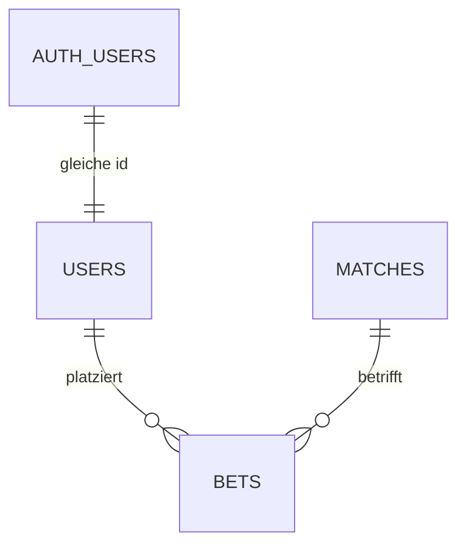

# Datenmodell

Stand: Migration `002_game_economy.sql` (November 2026)

Die Datenbank liegt bei Supabase (PostgreSQL). Alle Tabellen haben Row Level Security aktiviert und keine Policies. Zugriff hat nur das Backend über den Secret Key.

## Beziehungen

`kurs` und `system_values` stehen für sich und haben keine Beziehungen.

## Tabellen

### users

Ein Spieler. Die ID ist dieselbe wie in Supabase Auth.

| Spalte          | Typ         | Pflicht | Hinweis                                                                       |
| --------------- | ----------- | ------- | ----------------------------------------------------------------------------- |
| id              | uuid        | ja      | Primärschlüssel, verweist auf `auth.users(id)`, wird beim Löschen mitgelöscht |
| username        | text        | ja      | derzeit die E-Mail-Adresse                                                    |
| coins           | integer     | ja      | Standard 50, nie negativ                                                      |
| becher          | integer     | ja      | Standard 0, nie negativ                                                       |
| last_collect_at | timestamptz | nein    | Zeitpunkt des letzten Sammelns, leer bis zum ersten Mal                       |
| created_at      | timestamptz | ja      | wird automatisch gesetzt                                                      |

### bets

Eine Wette eines Spielers auf ein Spiel.

| Spalte     | Typ         | Pflicht | Hinweis                                              |
| ---------- | ----------- | ------- | ---------------------------------------------------- |
| id         | bigint      | ja      | Primärschlüssel, wird automatisch hochgezählt        |
| user_id    | uuid        | ja      | Fremdschlüssel auf `users.id`                        |
| match_id   | bigint      | ja      | Fremdschlüssel auf `matches.fixture_id`              |
| stake      | integer     | ja      | Einsatz in Coins, größer als 0                       |
| odds       | numeric     | ja      | Quote zum Zeitpunkt der Wette                        |
| prediction | text        | ja      | `home`, `draw` oder `away`                           |
| status     | text        | ja      | `open`, `won` oder `lost`, Standard `open`           |
| payout     | integer     | nein    | Auszahlung in Coins, wird bei der Auswertung gesetzt |
| created_at | timestamptz | ja      | wird automatisch gesetzt                             |

### matches

Ein Bundesligaspiel, importiert von API-Football.

| Spalte                           | Typ     | Pflicht | Hinweis                                      |
| -------------------------------- | ------- | ------- | -------------------------------------------- |
| fixture_id                       | bigint  | ja      | Primärschlüssel, ID von API-Football         |
| fixture_date                     | text    | ja      | Anstoß als ISO-Datum                         |
| fixture_status                   | text    | nein    | zum Beispiel `Not Started`, `Match Finished` |
| league_id                        | bigint  | nein    | 78 = Bundesliga                              |
| league_name                      | text    | nein    |                                              |
| league_round                     | text    | nein    | Spieltag                                     |
| teamhome_name, teamaway_name     | text    | nein    |                                              |
| teamhome_logo, teamaway_logo     | text    | nein    | URL                                          |
| teamhome_winner, teamaway_winner | boolean | nein    | leer, solange das Spiel läuft                |
| goal_home, goal_away             | bigint  | nein    | leer vor dem Anpfiff                         |
| odd_home, odd_draw, odd_away     | real    | nein    | Quoten für 1, X und 2                        |

### kurs

Ein Becherkurs pro Berechnung. Der aktuelle Kurs ist die neueste Zeile.

| Spalte     | Typ         | Pflicht | Hinweis                                       |
| ---------- | ----------- | ------- | --------------------------------------------- |
| id         | bigint      | ja      | Primärschlüssel, wird automatisch hochgezählt |
| value      | numeric     | ja      | zwischen 0,5 und 2,0                          |
| created_at | timestamptz | ja      | wird automatisch gesetzt                      |

### system_values

Einfache Schlüssel-Wert-Paare für Systemwerte.

| Spalte | Typ  | Pflicht | Hinweis                                       |
| ------ | ---- | ------- | --------------------------------------------- |
| key    | text | ja      | Primärschlüssel, zum Beispiel `current_round` |
| value  | text | ja      |                                               |

## Migrationen

Die Dateien liegen in `db/migrations/` und werden der Reihe nach einmal im Supabase SQL Editor ausgeführt.

| Datei                    | Inhalt                                                     |
| ------------------------ | ---------------------------------------------------------- |
| `000_initial_schema.sql` | Ausgangsstand: `matches` und `system_values`               |
| `001_users_and_bets.sql` | `users` mit Auth-UUID, `bets` mit Fremdschlüsseln          |
| `002_game_economy.sql`   | Coins, Becher, Sammelzeitpunkt, Auszahlung, Tabelle `kurs` |

## Offene Punkte

- `matches.fixture_date` ist `text`. Besser wäre `timestamptz`, dann kann die Datenbank Zeiten direkt vergleichen, zum Beispiel für den Wettschluss.
- Die Quoten in `matches` sind `real`, in `bets` aber `numeric`. Einheitlich `numeric` wäre sauberer.
